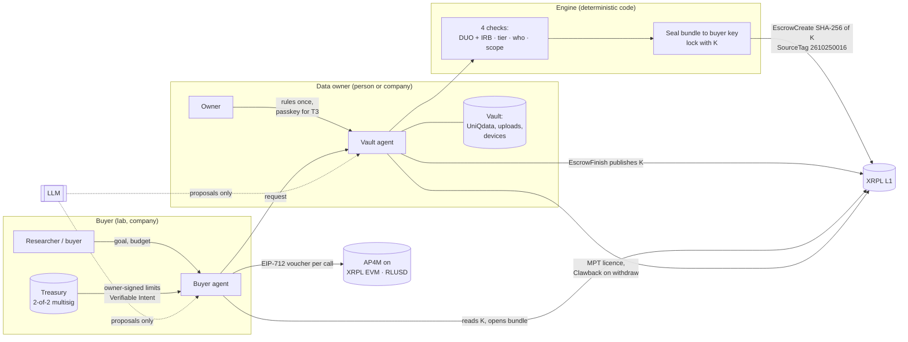

<p align="center">
  
</p>

<p align="center">
  <b>Every data vault gets an agent that trades on its owner's terms, and settles on XRPL.</b>
</p>

<p align="center">
  <a href="https://agentrail-try-production.up.railway.app/apps/try/">Try it live</a> ·
  <a href="https://data-vault-market-production.up.railway.app">Data Vault Market</a> ·
  <a href="#mastercard-ap4m-payments-on-xrpl-evm">AP4M receipts</a> ·
  <a href="#run-results-on-xrpl-testnet">Run results</a> ·
  <a href="docs/DETAILS.md">Full technical record</a>
</p>

XRPL AI & Fintech Hackathon NYC 2026 (Oct 24–25) · Team **SportiQue** · Track: **Agentic Finance**

> **Vault Agent** was called **AgentRail** during the build. The repository, the Railway URLs and the
> code (`agentrail/`) keep that name. Everything here was built during the hackathon; reused material is
> listed in [docs/REUSE_LOG.md](docs/REUSE_LOG.md).

---

## Why

Sharing data between two parties is slow because four things have to happen by hand: match the data to
the need, check it is what was promised, agree who may use it, and settle the payment. A research data
access agreement takes a **median of 80 days**. Agents can do that work, but they need a rail that
enforces *who* the agent acts for, *how far* it may go, and *on what terms*. In health data, consent is
needed for every item, and a leaked genome cannot be taken back.

Vault Agent gives each data vault, whether it belongs to a person or a company, its own agent. The
agent finds buyers, checks every request against its owner's rules, and gets paid on XRPL only when the
buyer can actually open the data.

**The LLM proposes, code verifies, the ledger enforces.**

## Two products on one engine

| | **Data Vault Market** | **UniQdata × UniQLab research contracts** |
|---|---|---|
| Who | anyone with data: people and companies | research participants (UniQdata) and research institutions (UniQLab) |
| What the agent does | sorts the vault into packages, answers buyer requests, builds a lot only when it reaches k = 5 people, negotiates, and sells | reads every study posting, shows the person only the studies that fit, contributes each week inside the consent the person gave, and refuses the rest |
| Owner's role | upload and set rules once; one tap on the signing sheet | consent once per institution with a passkey; fresh approval for MRI, CT and genomic data |
| Payment | key-reveal escrow on XRPL, or one AP4M voucher per leg (RLUSD on XRPL EVM) | per delivered member-week: XRPL escrow, or the AP4M rail |
| Live | [data-vault-market-production.up.railway.app](https://data-vault-market-production.up.railway.app) | [/try](https://agentrail-try-production.up.railway.app/apps/try/) → research contracts, researcher console, participant app |
| Code | `prototypes/data-vault-market/` ([PR #79](https://github.com/SportiQue-inc/xrpl-hackathon-nyc-2026/pull/79)) | `agentrail/research_contracts.py`, `apps/contracts/`, [docs/RESEARCH_CONTRACTS.md](docs/RESEARCH_CONTRACTS.md) |

Both products use the same pieces: owner-signed limits, sealed delivery, key-reveal escrow, a licence
the owner can take back, and AP4M payments.

## How the agent decides

Every request passes four checks, in this order. Any check can narrow the result, and none of them can
widen it. You can try it at [`/apps/decide`](https://agentrail-try-production.up.railway.app/apps/decide/)
(`POST /api/agent/explain`, `agentrail/catalog/explain.py`).

1. **Rules that travel with the data.** The request must carry every GA4GH DUO code its items need. T2
   and higher need a verified ethics (IRB) credential on the ledger. Genomic data needs GSO.
2. **Sensitivity tier.** The owner's standing grant can cover T0–T2. **T3 is never covered.**
3. **Who is asking.** The institution's class (academic, hospital, commercial) and country are checked
   against the grant. A transfer abroad counts as a new scope.
4. **Standing scope.** A request inside the tier and purpose the owner already approved runs at once and
   is logged. Anything else goes to the safety gate and waits for the owner.

| Tier | Examples | Re-identification risk |
|---|---|---|
| **T0** everyday | steps, sleep, resting heart rate, HRV, SpO2 | low |
| **T1** lifestyle | meals, caffeine, mood, stress, fatigue, PSQI | moderate |
| **T2** clinical | diagnoses, prescriptions, HbA1c, LDL, blood pressure | high · IRB credential required |
| **T3** highly sensitive | **genomic variants, CT, MRI**, mental health diagnoses | identifying by itself · **fresh passkey approval every time** |

**MRI, CT and genomic data need a fresh approval every time.** These items enter only through
UniQdata's DataQ intake. The package the owner signs shows the institution, the purpose, the
re-identification risk and, for a genome, a warning about blood relatives. The owner approves with a
passkey assertion bound to that package's hash. Stale assertions, assertions from another device and
assertions for another package are refused. A genome leaves only as an aggregate over the study's signed
loci. Full catalogue: [docs/CATALOG.md](docs/CATALOG.md).

**Security layer.** After an approval, the following protect the data:

| Layer | What it guarantees |
|---|---|
| Passkey signature | the owner signs the exact package (institution, items, weeks, payment) on their own device |
| Consent hash on the ledger | every escrow memo carries the hash of what was approved |
| Sealed delivery | the bundle is encrypted to the buyer's key; the operator cannot open it |
| Key-reveal escrow | payment releases only when the key to the data is published on XRPL |
| Licence clawback | on withdrawal, the buyer's data licence (MPT) is taken back on the ledger |
| Owner-signed limits | Mastercard Verifiable Intent L1 → L2 → L3 is checked before every payment; the treasury needs 2-of-2 multisig |

In the synthetic simulation (50 owners, 6 studies), owner actions drop from **11,600 column approvals
to 233 passkey approvals** ([docs/CATALOG.md](docs/CATALOG.md)).

## Mastercard AP4M payments on XRPL EVM

The agent pays per call over HTTP 402. Each call is an EIP-712 voucher on an AP4M channel, redeemed
on-chain, and settled in RLUSD on **XRPL EVM Testnet** (chain 1449000). XRPL EVM is a separate chain
from the XRPL ledger used for escrow. The agent decides each payment by itself, against a per-call cap,
a total budget, a payee allowlist and the person's consent.

**First live run, 2026-10-25** ([`ap4m/receipts/run-2026-10-25T14-59-45-563Z.json`](ap4m/receipts/run-2026-10-25T14-59-45-563Z.json)):
task "contribute P-017 weeks 3–5 to study SLEEP-01", cap 0.10 RLUSD per call, budget 0.20 RLUSD.

| Call | Decision | Reason | On-chain |
|---|---|---|---|
| week 3 · 0.05 RLUSD | **pay** | within cap and budget, payee allowlisted, purpose HMB matches consent | [VoucherRedeemed 0x318d…](https://explorer.testnet.xrplevm.org/tx/0x318db4c2ace3b95496017f46bdfea617b9e32a2d6ddd1f1ddde0e538b7b2c7a9) |
| week 4 · 0.05 RLUSD | **pay** | same checks; running total 0.10 | [VoucherRedeemed 0x4990…](https://explorer.testnet.xrplevm.org/tx/0x4990ef4459b2fd171782b384950e8843cbf92f0a82c2612465a7df2457b52bb9) |
| week 5 · 0.05 RLUSD | **pay** | same checks; running total 0.15 | [VoucherRedeemed 0x7e27…](https://explorer.testnet.xrplevm.org/tx/0x7e27a882ad4eef6e2d1f28163bcde5f9d279f3a83ba15de7d19475ff08e8c1aa) |
| week 6 · 0.50 RLUSD | **refuse** | price exceeds the 0.10 per-call cap | nothing paid |

Settlement: [settlement tx](https://explorer.testnet.xrplevm.org/tx/0xc675193632e48c3fe6ab48e5010b245300cd18f2a6d774c7a73c8c92762dba1e) ·
[payout tx](https://explorer.testnet.xrplevm.org/tx/0xaece2663f7e33bc7cb5274b259428f3c60b32f69e8f020abe80faa61e5d98db7) ·
[payout wallet](https://explorer.testnet.xrplevm.org/address/0x7BA281DF7cC4A40159Ca957A6a969b9495464160)
went from 0 to **0.15 RLUSD**. All 3 AP4M receipts pass `verify-receipt.mjs`.
`GET /api/public/ap4m?verify=1` checks each VoucherRedeemed again on an XRPL EVM node.

| PR | What it adds |
|---|---|
| [#77](https://github.com/SportiQue-inc/xrpl-hackathon-nyc-2026/pull/77) | the live AP4M payments with on-chain receipts, shown in `/console#/evidence` and `/try`, and the shared AP4M rail service (`ap4m/rail-server.mjs`) |
| [#79](https://github.com/SportiQue-inc/xrpl-hackathon-nyc-2026/pull/79) | Data Vault Market deals paid on AP4M: one voucher per leg, capped at 0.10; the merchant response releases the data key K |
| [#78](https://github.com/SportiQue-inc/xrpl-hackathon-nyc-2026/pull/78) | research contracts pay every delivered member-week through the same rail and run their rounds on their own |

Details: [ap4m/README.md](ap4m/README.md).

## XRPL L1: key-reveal escrow and the team source tag

The core trade runs on the XRPL ledger itself:

1. The seller's agent encrypts the bundle with a fresh key **K** and seals it to the buyer's key.
2. The buyer locks payment with **`EscrowCreate`** and a PREIMAGE-SHA-256 condition on K. The memo
   carries the order id, the bundle hash and the consent hash, never data.
3. The buyer checks provenance before any payment. A tampered record fails here and is paid **0**.
4. The seller's agent publishes K in **`EscrowFinish`** to get paid, so payment and the key to open the
   data are the same event. A withheld key or a withdrawal leads to **`EscrowCancel`** and a refund.
5. The buyer reads K from the ledger and opens the bundle. Anyone can replay this check with
   `python scripts/open_bundle.py <EscrowFinish hash>`.

These run alongside it: an MPT data licence with Clawback, Credentials with DepositPreauth (KYB), a
multi-signed treasury, a Batch with all-or-nothing escrows, XLS-85 token escrow in USD, the AMM, and x402
through the T54 facilitator. [docs/DETAILS.md §4](docs/DETAILS.md#4-xrpl-implementation) has a Testnet
link for each.

**Source tag `2610250016`.** Every XRPL L1 transaction we sign carries the team SourceTag. It is applied
in one place, at xrpl-py's autofill, which every sign path goes through
([`agentrail/ledger/source_tag.py`](agentrail/ledger/source_tag.py), `tests/test_source_tag.py`). Set
`XRPL_SOURCE_TAG` to change it, or `XRPL_SOURCE_TAG=off` to turn it off.

## Live links

| | URL |
|---|---|
| **Try it** (start here) | https://agentrail-try-production.up.railway.app/apps/try/ |
| **Data Vault Market** | https://data-vault-market-production.up.railway.app |
| How my agent decides | https://agentrail-try-production.up.railway.app/apps/decide/ |

All people, institutions and records are synthetic. Payments run on XRPL Testnet and XRPL EVM Testnet.

## Run results on XRPL Testnet

Each run is a separate execution of `scripts/run_engine.py` against XRPL Testnet, with its own
participants, wallets and commit. Each run's numbers stand on their own and should not be added to or
compared with another run's numbers.

### Run C: 50 participants, settled in the USD token (commit f397ad8)

`LEDGER=testnet SETTLE_ASSET=USD python scripts/run_engine.py` · 50 UniQdata participants on their own
wallets · 11:16–13:06 UTC · **10 of 12 flows pass**

| Flow | Result | Evidence |
|---|---|---|
| Proposal, consent | pass (50 consents) | |
| Co-signed budget | pass (40 USD) | [tx](https://testnet.xrpl.org/transactions/1E0F23502049667CE971C269638A9706F0CC871431A8BDD5318C67280FFB0FF7) |
| Escrow | pass (95 EscrowCreate) | [tx](https://testnet.xrpl.org/transactions/029B779D01E021A99D91B14B16563FEBE866E9AFED1D6B32D812CE315BC9B379) |
| Key reveal | pass (94 EscrowFinish) | [tx](https://testnet.xrpl.org/transactions/0427F2F1D6E563094BD5846930587F91EDEAB3E2E7129069306B1435E6E8F19A) |
| Holdback | pass (45 released, 2 returned, 1 withheld) | [tx](https://testnet.xrpl.org/transactions/40F9884D14AAD6147EEA1BBE6A2AC6CFAE877A43758828454A2D08020CDBBEB8) |
| Withdrawal: MPT clawback and refund | pass | [tx](https://testnet.xrpl.org/transactions/58BFD0C269CE3DD3F5A1F4AEC193FD76388B7FB262978BBBEA4F014C473922B0) |
| Batch | pass (30) | [tx](https://testnet.xrpl.org/transactions/E227B6A992ECF80F949267BD1F989DF9CC69C202C9162A3C84ABCE10CF7A2C37) |
| Data contracts | pass (10) | [tx](https://testnet.xrpl.org/transactions/246067B98C186263D31F37C4F391BA861E47C83FD7AF3947671105373189E607) |
| Contribution holdback | pass (9 released, 1 withheld) | [tx](https://testnet.xrpl.org/transactions/1D17C278CB0115C4B536C3FE5E8DAEC807660090881BA1A6AFECCD47AF315AF8) |
| AMM | not run (no participant chose a stablecoin payout) | |
| x402 | not passed (fee paid `tesSUCCESS`, but parsed with the token parser; fixed in the next commit) | |

### Run D: 21 participants, settled in the USD token (commit 65be74c)

`COHORT_N=20 SETTLE_WORKERS=8 LEDGER=testnet SETTLE_ASSET=USD python scripts/run_engine.py` · 21 UniQdata
participants on fresh wallets (20 plus the demo participant P-017) · 15:01–15:44 UTC · Send step about
9 min 45 s · 179 Testnet transactions, 22,235 drops in fees, 13 licences · **11 of 12 flows pass,
including x402**

| Flow | Result | Evidence |
|---|---|---|
| Proposal, consent | pass (20 consents) | |
| Co-signed budget | pass (40 USD) | [tx](https://testnet.xrpl.org/transactions/1D06555F94A944AD6CC68F2F5D74E9EE4E5963582E6ED2DA0BC98CE7EF798F5C) |
| Escrow | pass (43 EscrowCreate) | [tx](https://testnet.xrpl.org/transactions/03C1AA362AE9E104263F3F6B173C70FDAE9394BEC70E1467CE4B5A4D05CB5B31) |
| Key reveal | pass (42 EscrowFinish) | [tx](https://testnet.xrpl.org/transactions/04E9E109D0AB757F0759152BFDBA0E60A37BA0BE957EEC877FEA14D47539A2A3) |
| Holdback | pass (16 released, 2 returned, 2 withheld) | [tx](https://testnet.xrpl.org/transactions/E36F9B714B53920805BD45A671B02DE547A72E241F5843CF26AFC99039B1B261) |
| Withdrawal: MPT clawback and refund | pass | [tx](https://testnet.xrpl.org/transactions/F9DC34DA5666C95303B14FC6120ECCE027D366F09B321B60344660024CA9A79F) |
| Batch | pass (10) | [tx](https://testnet.xrpl.org/transactions/369E667D24694A4D116193B8B91E5AF3190FEA1AACB1BA5FBBCF368D7FA54B6F) |
| x402 | pass (HTTP 402 then 200 through the T54 facilitator) | [tx](https://testnet.xrpl.org/transactions/2B1828DEF6D13F286DF54EB1B25E0A749534A2F13759EACFC6B015CC391CF9C9) |
| Data contracts | pass (10 contributions, 2 non-matching ones caught) | [tx](https://testnet.xrpl.org/transactions/09E5C7E9A20690BD402DE32E33C1662B0E611FD17FE1ADEB145E529D58A5F2C8) |
| Contribution holdback | pass (8 released, 2 withheld by the reviewer) | [tx](https://testnet.xrpl.org/transactions/05A774D9F41AE6AD268F419D10BF1C2843C032619510DF1B908E6EB3B2E1F765) |
| AMM | not run (no participant chose a stablecoin payout) | |

Earlier runs (A: 50 people in XRP; B: 50 people in USD), the T3 trades from UniQdata intake, and the
standalone checks with their expected refusals are listed in
[docs/DETAILS.md §4](docs/DETAILS.md#4-xrpl-implementation) and
[xrpl_checks/RESULTS.md](xrpl_checks/RESULTS.md).

## Architecture



The LLM only proposes: it reads gaps, summarises requests and reads licence text. Code recomputes every
proposal and can only narrow it. Money and permissions are widened only by owner signatures and the
ledger (`test_hostile_llm_can_only_narrow`).

| Path | What |
|---|---|
| `agentrail/` | engine: agents, consent and scope checks, orders, outbox, ledger adapters, research contracts |
| `agentrail/ledger/` | XRPL: escrow, token escrow, MPT licence, credentials, multisig, Batch, AMM, x402, source tag |
| `agentrail/catalog/` | T0–T3 catalogue, tiered consent, "how my agent decides" |
| `ap4m/` | Mastercard AP4M agent, merchant, shared payment rail (Node) |
| `apps/` | `/try`, researcher console, participant app, research contracts, decide (no build step) |
| `prototypes/data-vault-market/` | Data Vault Market ([PR #79](https://github.com/SportiQue-inc/xrpl-hackathon-nyc-2026/pull/79)) |
| `xrpl_checks/` | standalone checks for each XRPL feature, with expected refusals |

## Quickstart

```bash
python -m venv .venv && source .venv/bin/activate
pip install -r requirements.txt
cp .env.example .env                           # optional: LLM key; never committed

python scripts/run_engine.py                   # one full health trade on the mock ledger, a few seconds
LEDGER=testnet python scripts/run_engine.py    # same on XRPL Testnet (faucet wallets)
python scripts/run_engine.py --serve           # keep the API and pages up on :8000
```

`run_engine.py` drives one trade over HTTP, signing in as each party, and ends by printing one
PASS/FAIL row per flow, each with the transaction that proves it. Then open:

- `http://127.0.0.1:8000/apps/try/`: overview and entry points
- `http://127.0.0.1:8000/console`: researcher console
- `http://127.0.0.1:8000/participant?pid=P-017`: participant app

AP4M (needs a registered AP4M team, see [ap4m/README.md](ap4m/README.md)):

```bash
cd ap4m && npm test           # no network
DRY_RUN=1 ./run-live.sh       # no network: same decision logs
./run-live.sh                 # live on XRPL EVM Testnet
```

## Tests

```bash
python -m pytest -q           # full suite on the mock ledger, including 25 attack tests
cd ap4m && npm test           # AP4M agent policy, receipts decoder, payment rail
```

Highlights: `tests/test_security.py` (25 attacks: budget raise, replay, cross-person access, log
tampering, hostile LLM), `tests/test_payout.py` (withdrawal history is never a pay input),
`tests/test_contract.py`, `tests/test_research_contracts.py`, `tests/test_explain.py`,
`tests/test_source_tag.py`, `tests/test_ap4m_receipts.py`.

## Limits of this demo

- All data, people and institutions are synthetic. Testnets only. Not a medical device.
- The personal agents run in the service process as a simulation. In production they run on the owner's
  phone, and the wallet key moves there too. Keys are separated by owner but not yet held in an HSM.
- No external penetration test yet. On-chain amounts and addresses are public, so production would use
  per-study addresses or a payout service.
- Legal design notes (not legal advice): [docs/legal/README.md](docs/legal/README.md).

Full evidence, standards mapping (AP2, Verifiable Intent, ACP, x402, A2A, DUO) and security table:
[docs/DETAILS.md](docs/DETAILS.md) · API: [docs/API.md](docs/API.md) · Security: [docs/SECURITY.md](docs/SECURITY.md)

---

<sub>Testnet: test USD stands in for RLUSD. On XRPL Testnet we issue our own USD token, because only
Ripple can issue RLUSD; in production only the issuer and currency code change. AP4M settles in the
RLUSD test token on XRPL EVM Testnet.</sub>

<p align="center"><br><sub>Vault Agent by SportiQue</sub></p>
