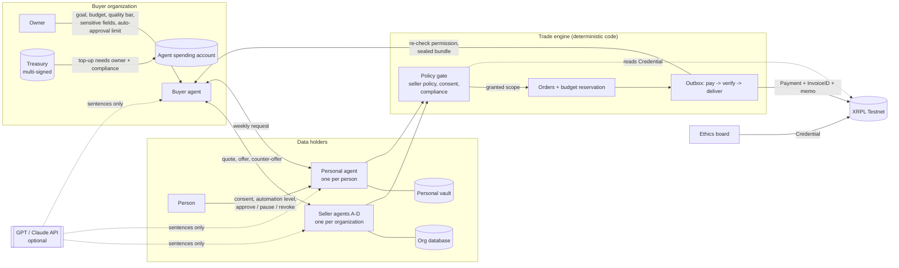

# AgentRail - agents that procure data within a mandate, settled on XRPL

XRPL AI & Fintech Hackathon NYC 2026 (Oct 24-25) - SportiQue team.
Track: **Agentic Finance**. Everything in this repository was built during the hackathon.

## 1. One line, and the problem

Give your agent a goal, a quality bar and a budget. It finds data held in other
organizations' (or people's) own databases, checks samples, negotiates with their
agents, pays each holder on XRPL and receives exactly what was agreed - and it **stops**
when a request falls outside what the holder allowed, even at a higher price.

Data that AI and research teams need (robot trajectories, sensor logs, personal health
time series) sits in many separate databases. Buying it today means emails, NDAs,
manual quality checks, invoices and one-off file drops. Agents can do the searching and
paying, but an agent that can pay is only safe if:

- it cannot spend beyond its mandate (budget, per-order limit, allowed purposes),
- the seller's terms - and, for personal data, the person's consent - are enforced by
  code, not by a prompt,
- every payment is tied to exactly one order, one data version and one usage scope.

## 2. Architecture



### The three agents

| Agent | Owner gives it | What it does |
|---|---|---|
| Buyer agent (`BuyerAgent`, `InstitutionAgent`) | goal, required fields and scenarios, minimum quality (sample missing / duplicate rate), sensitive-field allowance, auto-approval limit, budget and per-order limit (mandate) | discovery over seller catalogs -> sample quality check -> quote -> price negotiation -> cheapest combination that covers every required scenario within budget -> purchase -> receipt and report |
| Seller agents A-D (`SellerAgent`) | catalog, allowed purposes, excluded fields, licence, lowest acceptable price | answers quotes (full / counter-offer without excluded fields / decline), accepts an offer at or above its floor, otherwise counters at the floor |
| Personal agent (`PersonalAgent`) | per-institution consent (items, purpose, weeks), automation level (`confirm_each` / `auto_standard` / `auto_all`), minimum price, pause / revoke | provides consented items automatically, asks the person for anything outside consent, confirms sensitive items by name each round, blocks prohibited purposes |

Every step is written to a decision log that the dashboard shows as a conversation
(who -> whom, what, and the facts code decided).

### Where code decides and where the LLM speaks

| Decided by code (never by the LLM) | Written by the LLM (optional) |
|---|---|
| budget, per-order limit, reservation (`engine.place_order`) | the sentence each agent says in the log |
| seller policy, consent, sensitivity, compliance (`policy.py`) | explanations to the owner / the person |
| negotiation outcome (`SellerAgent.respond_to_offer`: floor rule) | |
| auto-approval limit, sensitive-field filter (`BuyerAgent.procure`) | |
| duplicate / conflict checks (order key), ledger verification before release | |

The LLM receives only the decision's facts (item names, prices, reasons), never raw data,
and its text is never parsed back into a decision. Without a key, or on any API error,
the agents use rule-based sentences and the run continues (`agentrail/llm.py`).
`test_llm_is_never_on_the_decision_path` feeds a hostile LLM reply and checks the
purchase is unchanged.

More detail (ERD, identifiers, order state machine): [docs/DESIGN.md](docs/DESIGN.md).

## 3. XRPL implementation

| XRPL feature | Why | How | Code | Testnet evidence |
|---|---|---|---|---|
| `Payment` with `InvoiceID` + memo | one payment per order, matched to order and terms | `InvoiceID` = order key; memo = order id, bundle hash, consent/terms hash; signed blob and hash stored **before** submit; lost response -> look up by hash, resubmit same blob | `engine._pay`, `ledger/xrpl_ledger.py` | [B1 purchase](https://testnet.xrpl.org/transactions/339DF06F94E57C92978A4815BAFFD8CB837E593305301F06A99D4BD4DC771902), [weekly payment to a person](https://testnet.xrpl.org/transactions/170A308F4B9C71C48217CAD45BAA0968C4A30B5F849A6CDB123C2248BB3FD2F7) |
| Validated-ledger check | data is released only after settlement | destination, amount, `InvoiceID`, `tesSUCCESS` and `validated` checked before delivery; permission re-checked just before release | `engine._release`, `XrplLedger.lookup` | [recovered order (scene C)](https://testnet.xrpl.org/transactions/170AFDAFA8E21E56BF5414BAC1DE7B57B1DDA1B7A9AE84783BCBADEAAF3A9E30): lost ack + restart, one payment |
| Multi-signing | an agent cannot raise its own budget | buyer treasury has a SignerList (owner + compliance, quorum 2) and master key disabled; agent-only top-up is rejected by the ledger (`tefBAD_SIGNATURE`/`tefBAD_QUORUM`); co-signed top-up raises the mandate | `ledger/xrpl_extras.py`, `scenario.top_up` | [SignerListSet](https://testnet.xrpl.org/transactions/0271D31421D869DC7BCEA5EC5384BB21B59E3AAC41464BA27305F5763F1EC3E6), [master key off](https://testnet.xrpl.org/transactions/D4A4D4E26B15A0E75BAEB0F1A72014FCAC8D21D1E311F3B50347E51600232EB9), [co-signed top-up](https://testnet.xrpl.org/transactions/06F45F9E79D899534C5F232CF31B26AB51F919834B63B5412E6F3C696B434C3F) |
| Credentials | sensitive items only for an ethics-approved buyer | ethics board issues `ETHICS_REVIEW_SLEEP` (CredentialCreate + CredentialAccept); the consent policy reads the accepted credential from the ledger | `XrplExtrasMixin.issue_credential / has_credential`, `ComplianceRules` | [CredentialCreate](https://testnet.xrpl.org/transactions/8CD96B22DE3D4A31122B31C659397ED92FD6264FFDE5A7D359B837C715898BAA), [CredentialAccept](https://testnet.xrpl.org/transactions/EF323EA2408533E61623288827372D2F6BDEAEB0A9CEDC4F5E8046E051FFDB59) |
| x402 (T54 facilitator) | HTTP-native pay-per-request for agents | gate answers 402 PaymentRequirements; buyer presigns; facilitator verifies and settles; engine still confirms on a validated ledger | `ledger/x402_rail.py` (`PAYMENT_RAIL=x402`) | Testnet run pending |
| Many payees, parallel payments | weekly rounds pay each person directly | local sequence counter; 50-person cohort paid in parallel, once each | `XrplLedger._next_sequence`, `scenario.scene_d` | 53 public demo accounts verified (`scripts/check_addresses.py`) |
| QuickNode RPC | production endpoint | any rippled JSON-RPC via `XRPL_RPC_URL` | `ledger/xrpl_ledger.py` | config only |

Only hashes go on-chain: no health values, names or consent text. In production,
institutional budget top-up approvals would be signed with a hardware wallet such as Ledger.

## 4. Track and judging fit

| Criterion | How AgentRail meets it | Evidence |
|---|---|---|
| Agentic Finance track: agents that move money | buyer agents discover, negotiate and pay autonomously inside a mandate; holders' agents answer for them | scene A, scene B, `agents.py` |
| Safe autonomy | spending limits, consent and compliance are code; multisig treasury stops self-funding | `policy.py`, `engine.py`, 25 tests (`pytest -q`) |
| Idea (25%) | one engine for organization data and personal data; consent and sensitivity are part of the trade | sections 1-2, scene B |
| Implementation (25%) | Payment + InvoiceID + validated-ledger release, idempotent recovery, Credentials, Multi-signing, x402 rail | section 3, `tests/test_engine.py` |
| Demo (25%) | one command runs both scenes; dashboard shows agent dialogue, orders and explorer links | section 5 |
| Potential (25%) | any data holder with a connector can sell; people are paid directly per round | section 6 |
| Bonus: QuickNode | RPC endpoint configurable | `XRPL_RPC_URL` |
| Bonus: x402 | payment rail through the T54 facilitator | `PAYMENT_RAIL=x402`, `ledger/x402_rail.py` |

## 5. Demo scenes and how to run

**Scene A - organization to organization (robotics data).** Goal: night warehouse
navigation, LiDAR + IMU, dynamic obstacles + narrow aisles, commercial training. The
buyer agent skips raw video (sensitive, not allowed by its settings), excludes A1 (no
LiDAR), C2 (licence: evaluation only) and D1 (20% missing in sample), negotiates B1
20 -> 18 XRP and C1 15 -> 13 XRP, and buys B1 + C1 for 31 XRP. With a 28 XRP budget it
buys nothing and asks for +3 XRP; it cannot sign the top-up alone; owner + compliance
co-sign; it completes the purchase.

**Scene B - same engine, personal health data.** Three people with different
automation levels. Week 1 runs automatically within consent (one person confirms by
hand). Week 2 the lab also asks for fatigue survey and blood pressure at a higher price:
nothing extra is sent; people are asked. One person approves only the fatigue survey;
blood pressure (sensitive) stays blocked. Week 3 runs in the new scope without the
person opening the app. A pause stops the next week; an ad network with a prohibited
purpose is refused.

**Scene C - failures.** Same order twice, lost payment response, lost delivery ack,
server restart: one order, one payment, same bundle re-delivered.

```bash
python -m venv .venv && source .venv/bin/activate
pip install -r requirements.txt
cp .env.example .env            # optional: put OPENAI_API_KEY=... in .env (never committed)
pytest -q                                          # MockLedger, all safety tests
python -m agentrail.scenario                       # all scenes on MockLedger
LEDGER=testnet python -m agentrail.scenario        # same scenes on XRPL Testnet (faucet wallets)
LEDGER=testnet PAYMENT_RAIL=x402 python -m agentrail.scenario   # settle via x402 facilitator
uvicorn agentrail.web:app --reload                 # dashboard at http://127.0.0.1:8000
```

`.env` settings: `LLM_PROVIDER` (`openai` | `anthropic` | `none`), `OPENAI_API_KEY`,
`OPENAI_MODEL`, `XRPL_RPC_URL`, `PAYMENT_RAIL`. Testnet wallets are created from the
faucet at run time and kept only in `wallets.local.json` (git-ignored).

## 6. Safety, privacy, limits

- All organizations, people, records and amounts are **synthetic**. XRPL Testnet only.
- The service does not hold anyone's funds: buyers pay holders directly. Secrets stay in
  `.env` / `wallets.local.json` (both git-ignored); the engine stores signed blobs and
  hashes only.
- Raw data never goes to an LLM or on-chain. Bundles are sealed to the buyer's key; the
  gate operator cannot open them.
- Unknown state never becomes "allowed": an unreadable consent store holds the trade.
- Quality checks run on samples and are labelled "sample-verified", not a guarantee for
  the whole dataset.
- Pausing stops future releases; data already delivered cannot be recalled.
- Not a medical device; no diagnosis.

Next steps: escrow so payment releases on delivery, RLUSD pricing, aggregate products
across many people with minimum group sizes, production key custody for personal vaults.

See [docs/PLAN.md](docs/PLAN.md), [docs/DESIGN.md](docs/DESIGN.md),
[docs/DEMO_SCOPE.md](docs/DEMO_SCOPE.md), [docs/REUSE_LOG.md](docs/REUSE_LOG.md).
