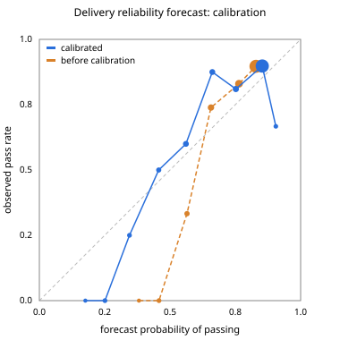

# Data contracts: from executing a trade to getting data that fits

Exchanging money for a key proves the buyer paid and could open the bundle. It does not prove the
records came from the source they claim, cover the period asked for, are in the right unit, or are
still usable once delivered. This layer adds that, in `agentrail/contract/`. Synthetic data only;
legal requirements are reflected in the design, this is not legal advice.

## 1. Column profile (provider's agent, on the device)

`profile.py`. For each column the provider's agent computes, from its own rows, and shares only
statistics: type, unit, source, sampling rate, completeness overall and per window, the value
distribution (n, mean, sd, quantiles), how completeness and quality behave over time (holding,
declining, recovering), a short-horizon forecast of both with a 90% band, the longest gap, and
day-of-cycle seasonality of missing records. The same profiler runs on wearable, survey or robot
sensor columns (`test_profile_shares_statistics_only_and_works_on_robot_columns`). It describes
data behaviour, never anything about the person.

## 2. Per-column requirements (buyer's agent)

`terms.Requirements`: required or nice-to-have per column, unit, windows, drift tolerance,
acceptable substitutes (the same measure from another registered source), the tier asked for and
the lowest tier accepted. Tiers are fixed quotes: A (5 of 7 days, full price), B (4 of 7, 80%),
C (3 of 7, 60%).

## 3. Negotiation between the agents (no humans in the loop)

`terms.negotiate` matches requirement to profile column by column and repairs what does not fit,
in a fixed order: the column as asked; a substitute column for the windows where it falls short; a
shorter period (never below the buyer's minimum); a lower tier the buyer accepts. A window is
offered only when the forecast says it meets the tier's minimum with 75% probability. Imputation is
never offered. Price is never haggled. A column outside the owner's consent, a sensitive column or
a new purpose stops the negotiation and goes to the owner (`needs_owner`); nothing else reaches a
person. Every move is a message in the transcript returned with the contract.

Example (`market.scripted_decliner`, `test_agents_agree_on_a_substitute_and_a_shorter_period_instead_of_failing`):
the chest band's resting heart rate falls week after week, sleep slips slowly, and the same person
also wears device B. As asked (chest band, four windows) two or more windows fail on completeness.
Negotiated, the agents agree on resting heart rate from device B and two windows instead of four;
both windows pass.

The contract (columns, sources, units, thresholds, windows, tier, purpose and DUO codes, the
provider's holder key) is hashed. The hash goes into the EscrowCreate memo next to the bundle hash
(`contract:<16 hex>`), and the full contract, the native values and the manifest are sealed inside
the bundle, so the payment and the check refer to the same terms. The escrow condition itself stays
SHA-256 of the data key, which is what makes the key reveal pay.

## 4. Provenance chain

`provenance.py`. The issuer of each column (device vendor, survey app, clinic) signs every export:
the column, the slots it covers, a hash of the native values, and the holder key it was made for.
An issuer counts only when a registry has issued it a `DATA_SOURCE` Credential on the ledger and
its signing key is registered. The bundle carries the native values and the normalization steps
(rename, unit factor); the buyer re-runs them and must get exactly the delivered column. The
manifest (contract hash, consent version hash, attestations, normalization, the provider's QC
counts) is signed by the holder key. A file hash alone would only show the bytes did not change.

## 5. Fitness of each contribution, as it arrives

`fitness.py`, `round.py`. Before any escrow (nothing paid yet): manifest signature, contract hash,
issuer signatures and Credentials, export made for this holder, slots inside the window
(`wrong_source`, `different_person`, `wrong_period`), and the source's provenance seal: the sealed
bytes are the ones the issuer signed and they open with this escrow's condition (`tampered`, 0 paid).
After the key is revealed (the continuity-curve share paid): values
match the attestation (`tampered`), completeness per column (`incomplete`), unit range with a
factor-60 check (`wrong_unit`), drift from the profile the contract was agreed on (`drift`), the same
series from another provider (`duplicate`). The part held for that contribution, in its own escrow,
is released only after a pass. A failure goes to a named reviewer; if the reviewer confirms it is
unfit but not fraud, the held part returns to the study and nothing else changes for the provider
(no exclusion, no repayment claim). A failed provider is replaced for the remaining windows.

After every contribution the round updates a projection: usable so far, expected final usable with
a 90% band, the power that implies for the analysis, and the windows at risk ("2 providers at risk
of missing window 7"). `GET /api/contract/projection` returns it with the contracts, transcripts and
per-contribution tx links, ready for a live gauge.

## 6. Delivery reliability forecast

`forecast.py`. The probability that one provider's contribution for one window passes its check on
time. Inputs are delivery behaviour only: forecast completeness margin over the contract minimum,
whether a column is declining, device sync regularity, the source's pass rate so far, the
provider's pass rate this round, drift so far. Decline, pause or withdrawal history, health values
and demographics are refused as inputs (`test_forecast_uses_only_delivery_behaviour`). It ranks
providers by expected usable windows per XRP and triggers early backups; it never changes what
anyone is paid. Logistic regression in plain Python, every weight readable.

## 7. Measurement (synthetic)

`python scripts/measure_contracts.py`. The market generator gives each provider columns that hold,
decline or recover, device sync regularity, and with some probability a bad record from a window on
(wrong source, wrong period, another person's export, wrong unit, a duplicate account, sensor
drift). Cheaper providers skew towards irregular sync and faults. These are assumptions of the
generator, not measurements of a real market.

Forecast: logistic regression fitted on 673 synthetic contributions, calibrated (Platt scaling) on
337 others, reported on 337 more that neither step saw (pass rate 0.79).

| | Brier score | expected calibration error |
|---|---|---|
| always predict the base rate | 0.133 | |
| logistic, before calibration | 0.118 | 0.080 |
| logistic + Platt calibration | 0.114 | 0.059 |

Before calibration the model was too confident in the middle (0.5-0.6: predicted 0.57, observed
0.33) and too cautious at the top (0.8-0.9: predicted 0.83, observed 0.90). After calibration the
top bin reads 0.85 against 0.90 and the 0.4-0.6 bins sit within 0.05; the 0.6-0.7 bin is still
under (0.66 against 0.88, n = 16). Isotonic regression is also implemented
(`measure.train(calibration="isotonic")`, Brier 0.115, ECE 0.075). Plot, both curves:
`docs/img/reliability.svg`.



Same target (40 usable provider-windows), same five synthetic markets of 150 providers:

| | usable (mean) | target met | unfit contributions paid for | XRP paid for unfit | XRP per usable | unfit rate |
|---|---|---|---|---|---|---|
| manual: lowest price, terms as asked, paid in full, reviewed at the end | 20.6 | 0/5 | 19.4 | 1.079 | 0.115 | 0.485 |
| checks: negotiated contracts, incremental checks, 80/20 per contribution, replacement | 29.2 | 0/5 | 6.4 | 0.268 | 0.062 | 0.218 |
| forecast: the same, ranked by expected usable per XRP, early backups | 41.0 | 3/5 | 7.0 | 0.297 | 0.062 | 0.176 |

What it shows on this generator: catching bad records per contribution (about a fifth of them before any
payment) and holding 20% per contribution cuts what is paid for unfit data by about three quarters
and halves the cost per usable record. The forecast adds less than the checks do: a slightly lower
unfit rate, and it reaches the target more often (3 of 5 markets against 0 of 5) because it recruits backups before a window falls short. It
pays more in total for that.

## 8. Run it

```bash
python scripts/run_engine.py              # the full trade, then a data-contract round; 12 flows checked
python scripts/measure_contracts.py       # forecast calibration and the comparison above
python -m pytest -q tests/test_contract.py
```

## 9. Schema mapping: the LLM proposes, code verifies

`agentrail/contract/mapping.py`. Providers export in their own formats. Code parses six synthetic formats into flat fields (structure only): an Apple Health export (XML), Garmin and Fitbit style JSON, a FHIR Observation bundle (LOINC codes, `valueQuantity.unit`), a survey CSV and a robot sensor log. The LLM reads the field names, declared units, three example values and the contract's column meanings, and proposes for each column one field and its unit, or none. Code checks every proposal:

| check | rejects |
|---|---|
| field | a field that is not in the source |
| dimension | a duration offered for a rate, etc. |
| metadata | a unit that disagrees with what the source declares (FHIR `unit`, Apple `unit`, `InSeconds`, `_mg`, `_kmh`) |
| range | fewer than 90% of converted values in the column's possible range |
| typical | a median outside the column's typical band |
| name | a field whose own name or label contradicts the meaning (in bed, a sleep stage, average, self-report), or lacks a word the meaning needs (resting) |

A rejected mapping leaves the column unmapped for that source; nothing is guessed. Every proposal and verdict is kept in the proposals log.

**A second agent as another defense layer.** Names do not always speak (a generic export with columns `m1`, `m2`). So after code accepts, the provider's own agent, which knows its device and answers for what it delivers, reviews each accepted mapping against the column's meaning. It may object, or point at a better field in the same source; the better field goes back through every code check. It can narrow, never widen: it cannot accept what code rejected (tested).

Measured against ground truth, 13 cases per seed × 3 seeds (`scripts/measure_mapping.py`):

| proposer | correct | declined (rightly none) | caught by code | missed (wrong, accepted) |
|---|---|---|---|---|
| name-matching rules (no LLM) | 30 | 3 | 6 | 0 |
| scripted model with typical mistakes (tests) | 12 | 6 | 21 | 0 |

What code caught from the scripted model: FHIR sleep in hours called minutes, systolic blood pressure offered as resting heart rate, Garmin deep sleep offered as total sleep, Fitbit time in bed offered as time asleep, Apple average heart rate offered as resting, robot acceleration in mg called m/s², a field that does not exist. Before the name check, time in bed and average heart rate passed (plausible values in the right unit); the name check closes those, and the provider agent's review covers sources whose names say nothing (test with an opaque export: code accepts `m1`, the provider's agent replaces it with `m2`, code re-checks). The survey's self-reported sleep is a correct "none": the column asks for a device measure.

The run with the real LLM goes on the machine that holds the key (`LLM_RECORD=1 python scripts/measure_mapping.py`); the replay cache then lets anyone repeat it without a key.
