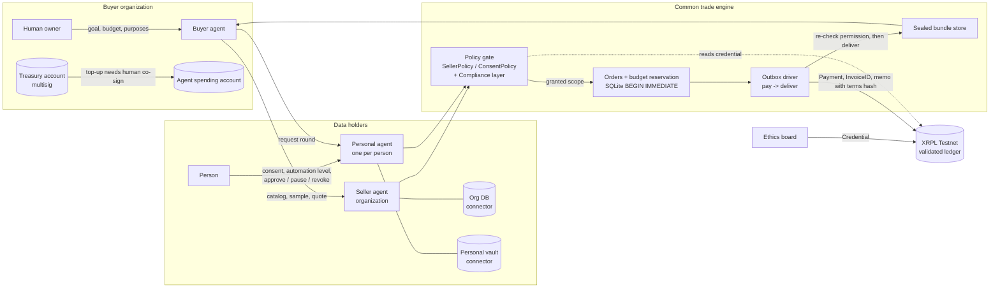
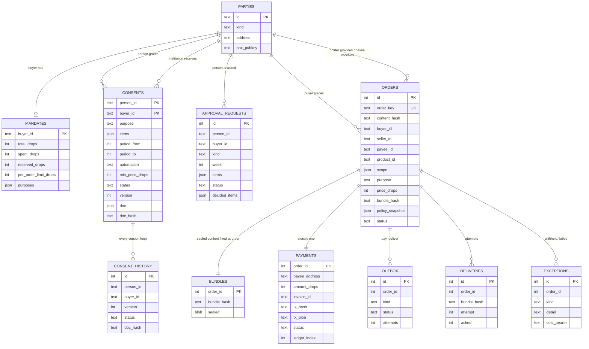
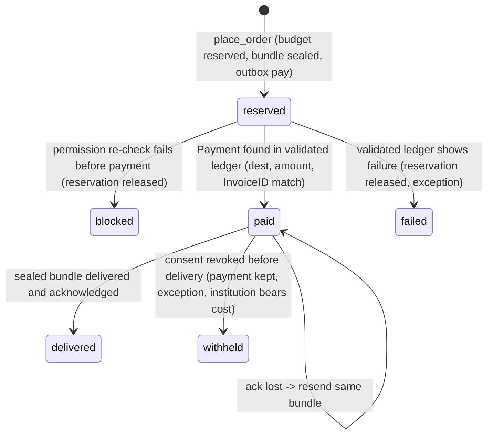
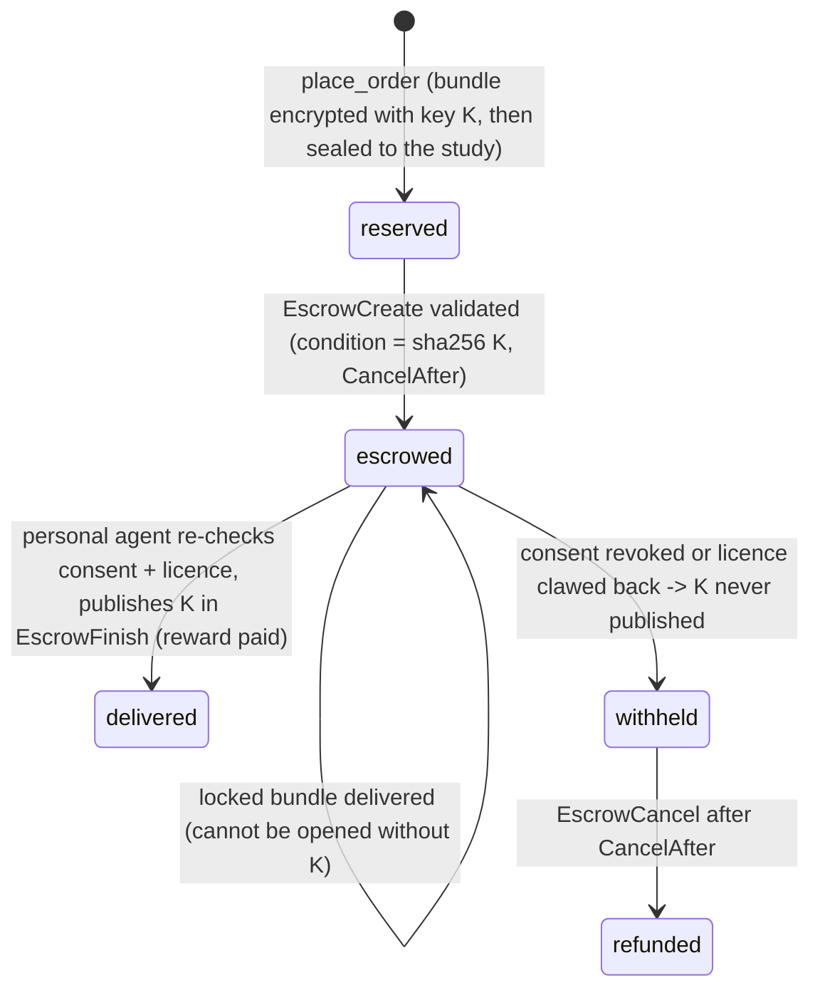

# AgentRail design

Status legend: **[done]** implemented and tested on MockLedger (Testnet run in progress) · **[wip]** being built
now · **[open]** decided later / out of hackathon scope.

## 1. Architecture

Rules that hold everywhere:

1. Agents propose; policies decide; the engine executes. An LLM only writes the
   agents' sentences; it is never on the permission or payment path. **[done]**
2. A trade runs only on the intersection of: holder permission AND buyer mandate AND
   available budget AND data actually available. **[done]**
3. Money moves only for a reserved order; data moves only after the payment is in a
   validated ledger and permission is re-checked. **[done]**
4. Unknown state never becomes "allowed": unreadable consent store -> hold. **[done]**

## 2. Entities (ERD)

Plus `events` (append-only decision log shown on the dashboard).
Data products of organizations live in the seller's own connector, not in the engine
DB: the engine only stores what was ordered (`scope`, `bundle_hash`). **[done]**

### Keys and identifiers

| Identifier | Built from | Purpose |
|---|---|---|
| `order_key` | sha256(buyer, holder, product, slot, purpose) | uniqueness; slot = `once` or `P017\|week2` |
| `content_hash` | sha256(payee, granted items, price, bundle_hash) | same key + different content -> conflict |
| `bundle_hash` | sha256(canonical rows) | data version fixed at order time |
| `invoice_id` | `order_key` | XRPL `InvoiceID` on the payment |
| `doc_hash` | sha256(canonical consent document) | which consent version a payment relied on |
| payment memo | `order:<id>\|bundle:<hash16>\|terms:<consent version+doc hash16>` | on-chain evidence, no personal data |

## 3. Order state machine **[done]**

Escrow orders (health study, `settle="escrow"`):

Payment step detail: sign -> **store hash + signed blob** -> submit -> look up by hash.
Lost response: look up. Not found and not expired: resubmit the same blob (applies at
most once). Expired (past `LastLedgerSequence`): re-sign. Restart: `recover()` drives
every pending outbox row.

## 4. Agent settings

| Setting | Owner | Where enforced | Status |
|---|---|---|---|
| total budget, per-order limit, allowed purposes | buyer org | `mandates` + `place_order` | [done] |
| over-limit / over-budget -> ask human, buy nothing | buyer org | `BuyerAgent.procure` | [done] |
| quality thresholds (missing, duplicates), required fields/scenarios | buyer org | `BuyerAgent` (sample-verified) | [done] |
| sensitive-field allowance, auto-approval limit | buyer org | `BuyerAgent.procure` | [done] |
| fixed published price and terms; buyer confirms terms before ordering | seller org / buyer | `SellerAgent.quote`, `contract` log | [done] |
| allowed buyers/purposes, excluded fields, licence, price floor | seller org | `SellerPolicy` | [done] |
| consent: recipient, purpose, items, weeks, min price | person | `PersonalConsentPolicy` | [done] |
| automation: `confirm_each` / `auto_standard` / `auto_all` | person | same | [done] |
| sensitivity tier per item; sensitive never auto under `auto_standard` | product rule | same | [done] |
| compliance layer: prohibited purposes; sensitive items only for ethics-approved buyers | platform | `ComplianceRules` | [done] |
| ethics approval as an XRPL **Credential** instead of a config list | ethics board | ledger lookup | [done] |
| settlement through the **x402** facilitator (T54, Testnet) | engine | `PAYMENT_RAIL=x402` | [wip] |
| verified organization (`VERIFIED_ORG` Credential) before any answer; DepositAuth on the participant account | registry / person | `ComplianceRules.verified_check`, XRPL DepositPreauth | [done] |
| per-(study, participant) licence MPT, clawback on revoke | person | `ledger/licence.py`, licence check before key | [done] |
| quasi-identifier combination refused | platform | `ComplianceRules.check` | [done] |
| buyer treasury with **multi-signing**; agent spends from a capped account; top-ups need human co-sign (production: approval signatures from a hardware wallet such as Ledger) | buyer org | XRPL SignerList | [done] |
| pause (forward only) / revoke (also withholds undelivered) | person | consent status | [done] |

## 5. Tests (MockLedger, real sealing, real SQLite) - `pytest -q`

| # | Property | Test |
|---|---|---|
| 1 | same order twice -> one order, one payment | `test_same_order_twice_...` |
| 2 | same key, different content -> conflict | `test_same_key_different_content_...` |
| 3 | concurrent orders -> no lost reservation, no overspend | `test_concurrent_orders_...` |
| 4 | restart after payment -> delivery recovered | `test_restart_after_payment_...` |
| 5 | delivery ack lost -> same bundle, no extra payment | `test_lost_delivery_...` |
| 6 | pause -> new orders blocked, history kept; pause before payment releases budget | `test_pause_...` (2) |
| 7 | revoke -> undelivered withheld, payment kept, exception | `test_revoke_...` |
| 8 | over limit / budget too small -> nothing paid, asks human | `test_over_limit_...` |
| 9 | payment response lost / request dropped -> recovered by hash, same blob | `test_lost_payment_...`, `test_dropped_submit_...` |
| 10 | outside consent waits for person even at higher price; approve D only, E stays blocked | `test_items_outside_consent_...` |
| 11 | `auto_standard` confirms sensitive items each round | `test_auto_standard_...` |
| 12 | sensitive filtered for buyer without ethics approval; prohibited purpose refused | 2 tests |
| 13 | unreadable consent store -> hold | `test_unreadable_consent_store_...` |
| 14 | payment memo carries consent doc hash | `test_payment_memo_...` |
| 15 | scene A picks B1 + C1 within budget, excludes A1 / C2 / D1 for the right reasons | `test_scene_a_...` |

## 6. Health study: both sides (`study.py`, `cohort.py`, `boundaries.py`)

| Step | Research side | Participant side | Ledger |
|---|---|---|---|
| set up | coverage table 50 x 8, protocol, treasury SignerList | consent per study (DUO codes), automation level | SignerListSet, ethics Credential, VERIFIED_ORG Credential, DepositAuth + DepositPreauth (P-017) |
| gap reading | LLM proposes gaps (table + note) and per-person gaps; code recomputes; stored in `proposals` | - | - |
| approval | budget via co-signed treasury payment | - | multisigned Payment; single signer refused |
| request | one participation request per person | agent answers auto / ask / blocked; card + preview | - |
| contribution | escrow per week | agent extracts (pseudonym, date shift, minimization), seals, publishes K | EscrowCreate, EscrowFinish (fulfillment = K) |
| licence | holds 1 unit | issues on first contribution | MPTokenIssuanceCreate, MPTokenAuthorize x2, MPT Payment |
| withdrawal | row greys out; refund | decline / pause / revoke | Clawback, EscrowCancel |

Per-study identity: `S-` + sha256(study, person)[:8]; day shift = sha256(study, person) mod 90 + 30,
kept only by the personal agent. Two quasi-identifiers in one request are refused by the compliance
layer before consent is read.

## 7. Open items

- **[done]** Key-reveal escrow (PREIMAGE-SHA-256) so the reward releases with the key.
- **[open]** RLUSD instead of XRP (needs trust lines and test RLUSD).
- **[done]** LLM (GPT by default) proposes gaps, schema mappings and licence readings; code
  verifies and can only narrow; answers recorded and replayed; rules when no key.
- **[open]** Retention / deletion of delivered copies after revoke: contract + audit,
  not technically enforceable.
- **[open]** Who pays account reserve for new personal accounts.
- **[open]** Production key custody for personal vaults; here keys are in memory.
- **[open]** Multi-holder products (one query spanning many people) and k-anonymity
  style thresholds for aggregates.
